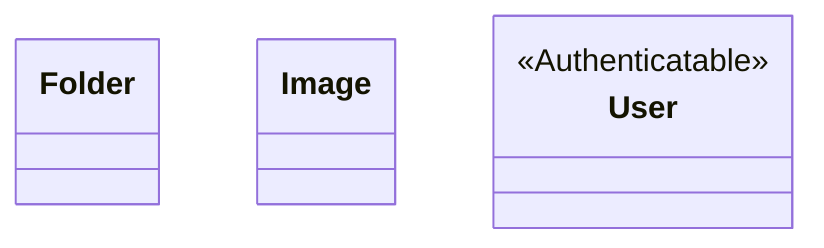

<!-- Generated by `bunx guren spec:generate` — do not edit by hand. -->

# Domain Model

Model classes and their declared relationships, grouped by module. Attributes live in the ER view (`er.md`).

## Models

- **Folder** (app/Models/Folder.ts) — table: `folders`
- **Image** (app/Models/Image.ts) — table: `images`
- **User** (app/Models/User.ts) — table: `users`
