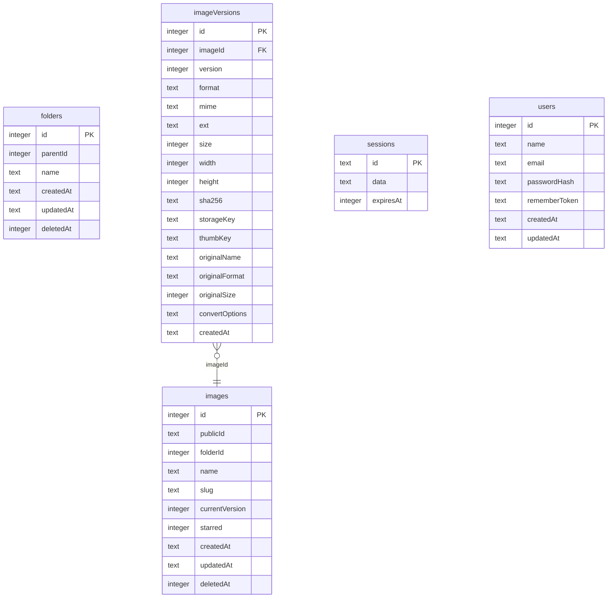

<!-- Generated by `bunx guren spec:generate` — do not edit by hand. -->

# ER Diagram

Entities and attributes are derived from `db/schema.ts` (and every module schema); edges from model relationship declarations and explicit `.references()` foreign keys.

This is a minimal, diff-able view. For interactive exploration of the Drizzle schema, tools like drizzle-lab or Liam ERD complement it.

## folders

| Column | Type | Constraints |
|--------|------|-------------|
| id | integer | primary key |
| parentId | integer |  |
| name | text | not null |
| createdAt | text | not null |
| updatedAt | text | not null |
| deletedAt | integer |  |

## imageVersions (table: image_versions)

| Column | Type | Constraints |
|--------|------|-------------|
| id | integer | primary key |
| imageId | integer | not null, references images.id |
| version | integer | not null |
| format | text | not null |
| mime | text | not null |
| ext | text | not null |
| size | integer | not null |
| width | integer | not null |
| height | integer | not null |
| sha256 | text | not null |
| storageKey | text | not null |
| thumbKey | text | not null |
| originalName | text | not null |
| originalFormat | text | not null |
| originalSize | integer | not null |
| convertOptions | text | not null |
| createdAt | text | not null |

## images

| Column | Type | Constraints |
|--------|------|-------------|
| id | integer | primary key |
| publicId | text | not null |
| folderId | integer |  |
| name | text | not null |
| slug | text | not null |
| currentVersion | integer | not null |
| starred | integer | not null |
| createdAt | text | not null |
| updatedAt | text | not null |
| deletedAt | integer |  |

## sessions

| Column | Type | Constraints |
|--------|------|-------------|
| id | text | primary key |
| data | text | not null |
| expiresAt | integer | not null |

## users

| Column | Type | Constraints |
|--------|------|-------------|
| id | integer | primary key |
| name | text | not null |
| email | text | not null |
| passwordHash | text | not null |
| rememberToken | text |  |
| createdAt | text | not null |
| updatedAt | text | not null |
