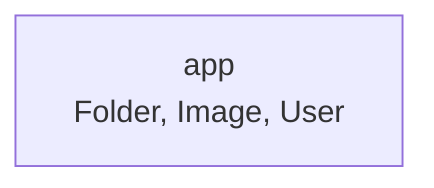

<!-- Generated by `bunx guren spec:generate` — do not edit by hand. -->

# Modules

This app has no `modules/` directory — all code lives at the application root.

## app

Models (3):

- Folder — app/Models/Folder.ts
- Image — app/Models/Image.ts
- User — app/Models/User.ts
